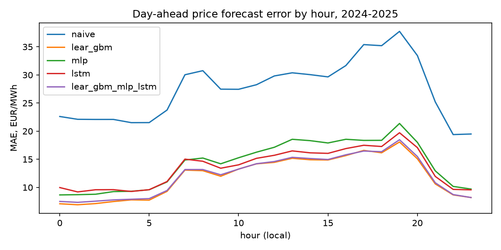
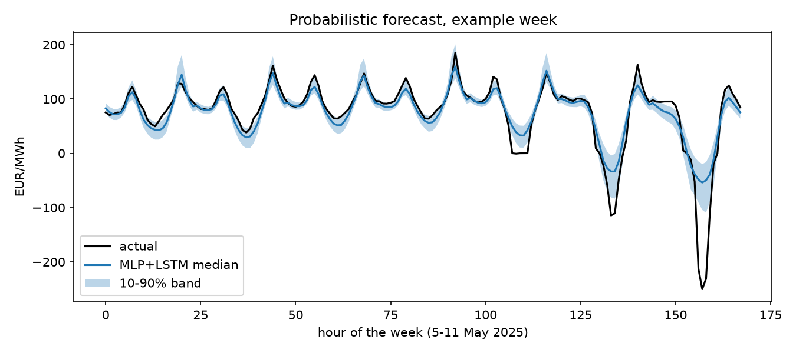

# de-price-forecast-service

Day-ahead power price forecasts for Germany (bidding zone DE-LU) with PyTorch neural networks,
served through a FastAPI endpoint, packaged as a Docker image and refreshed every evening by a
scheduled GitHub Actions job that also scores past forecasts against realised prices.

The forecasting study behind it, with LEAR and gradient boosting benchmarks, is
[de-power-market-ppa](https://github.com/michaelserikov/de-power-market-ppa) v0.5-v0.6. This
repository adds neural networks, a walk-forward comparison with those benchmarks on identical
inputs, and the engineering around a model that runs every day.

## Results (walk-forward backtest, 2024-2025, 731 days x 24 hours)

Each month is forecast by models trained only on the 728 days before it (monthly recalibration,
three seeds per network averaged). Inputs for day d are the information of day d-1: prices up to
d-1, the TSOs' day-ahead load, wind and solar forecasts for d, calendar, the last EU allowance
auction price and the previous month's TTF gas price.

| Model | MAE (EUR/MWh) | rMAE vs naive | RMSE | Pinball | 80% interval coverage |
|---|---|---|---|---|---|
| Naive (d-1 / d-7) | 27.38 | 1.000 | 43.18 | | |
| MLP (249 inputs, PyTorch) | 14.19 | 0.518 | 25.50 | 4.76 | 67.7% |
| LSTM (bidirectional over the 24 hours) | 13.52 | 0.494 | 24.73 | 4.59 | 67.0% |
| MLP + LSTM average | 13.19 | 0.482 | 24.44 | 4.41 | 70.9% |
| LEAR + gradient boosting (de-power-market-ppa) | **11.97** | **0.437** | 22.57 | | |
| LEAR + GBM + MLP + LSTM | 12.16 | 0.444 | 23.05 | | |

Findings:

- Both networks halve the naive error, and the LSTM is more accurate than the MLP (Diebold-Mariano
  p < 0.001): sharing information across the hours of the delivery day helps.
- The linear LEAR model combined with gradient boosting remains the best point forecast on these
  inputs (DM p < 0.001 against every network). This matches the literature, where well-specified
  LEAR models are hard to beat without careful hyperparameter search and larger ensembles.
- Adding the networks to LEAR + GBM does not help over the two years (12.16 vs 11.97); in 2025
  alone the four-model average is level with it (11.49 vs 11.53).
- The 10-90% quantile bands cover 67-71% of hours instead of 80%: the quantile networks are
  overconfident, as is common for pinball-trained networks with early stopping. Interval
  calibration is the first item of the next version.




## Service

```bash
pip install torch --index-url https://download.pytorch.org/whl/cpu
pip install -e ".[test]"
uvicorn dpfs.service:app --port 8000
```

| Endpoint | Returns |
|---|---|
| `GET /health` | status and whether a trained model is loaded |
| `GET /model` | members of the ensemble with training window, seed and validation loss |
| `GET /forecast?day=YYYY-MM-DD` | 24 hourly forecasts for the delivery day: 10%, 50% (point forecast) and 90% quantiles in EUR/MWh |

```bash
curl "http://localhost:8000/forecast?day=2026-01-02"
{"day": "2026-01-02", "unit": "EUR/MWh", "zone": "DE-LU",
 "hours": [{"hour": 0, "q10": -25.5, "q50": 14.2, "q90": 41.45}, ...]}
```

Inputs are downloaded from SMARD and the fuel sources on request and cached under `data/`. If
SMARD is unreachable, the cached weekly files are used. The service returns 404 when the TSO
forecasts for the requested day are not yet published and 503 when no model is trained.

### Docker

```bash
docker build -t dpfs .
docker run -p 8000:8000 dpfs
```

The image uses CPU-only PyTorch and ships the current model from `models/latest`. CI builds the
image on every push, starts the container and checks `/health` and `/model`.

## Daily job

`.github/workflows/daily.yml` runs `python -m dpfs.daily` every evening at 19:30 UTC, after the TSO
forecasts for the next day appear on SMARD:

1. refresh the data (cached between runs),
2. retrain the ensemble (three MLPs and three LSTMs on the last 728 days) when the model is older
   than 30 days,
3. forecast tomorrow and write `forecasts/<day>.csv`,
4. score every past forecast whose prices are published and update `forecasts/performance.csv`
   (MAE, pinball loss and 80% coverage), so live accuracy can be compared with the backtest,
5. commit the forecast and, after retraining, the model.

## Method

- **MLP:** the 249 inputs of the LEAR benchmark (prices of d-1, d-2, d-3, d-7; load and
  renewable forecasts of d, d-1, d-7; weekday; EUA; gas), two hidden layers (256, 128), dropout,
  output 24 hours x 3 quantiles.
- **LSTM:** a bidirectional LSTM (64 units) over the 24 hours of day d; each hour has 25 features
  (its price lags, the previous day's mean, minimum and maximum, load, renewable and residual load
  forecasts, hour and weekday encodings, EUA, gas).
- **Training:** prices and price features transformed with asinh((x - median) / MAD) as in LEAR,
  all features standardised on the training window; pinball loss for the 10%, 50% and 90%
  quantiles; Adam, early stopping on the most recent 10% of the window; quantiles sorted so they
  never cross; ensembles average the members quantile by quantile.
- **Evaluation:** MAE, RMSE, relative MAE against the naive forecast, Diebold-Mariano test on the
  daily L1 norm of the 24 errors, pinball loss and empirical coverage of the 10-90% band.

Reproduce the backtest (about 17 minutes on a laptop CPU):

```bash
python -m dpfs.backtest --baseline ../de-power-market-ppa/results/forecast
```

## Limitations

- The TSO wind and solar forecasts for day d are published on SMARD around 18:00 on d-1, after
  the 12:00 day-ahead auction. The price forecasting literature uses the same series; a trading
  desk would use its own weather-based forecasts available before noon.
- The EEX auction archive used for EU allowance prices ends in 2025 and the World Bank gas series
  is published with a lag of about a month; later days carry the last published value forward.
- Out-of-sample study and demonstration service on public data, not a trading system. No
  hyperparameter search yet; the networks use one fixed configuration.

## Next

- Calibrate the quantile bands (conformal adjustment on recent residuals) and track calibration
  in the daily scoring.
- Experiment tracking and model registry (MLflow), data-quality checks and a drift alert.
- Hyperparameter search and larger ensembles; deployment of the container to a cloud service.

## Tests

`pytest -q` runs 14 offline tests on synthetic data: feature construction and alignment, scaler
round trip, carry-forward of fuel prices, pinball loss, training of both networks (beats the
naive forecast, ordered quantiles), save and load of the ensemble, walk-forward without
look-ahead, the API endpoints and error codes, and the daily scoring and retraining rule.

## Data

SMARD (Bundesnetzagentur | SMARD.de, CC BY 4.0): day-ahead prices and TSO day-ahead forecasts.
World Bank Commodity Price Data (Pink Sheet), ECB reference rates and EEX primary auction results
for fuel and carbon prices. Raw data are downloaded on first use and not committed.
