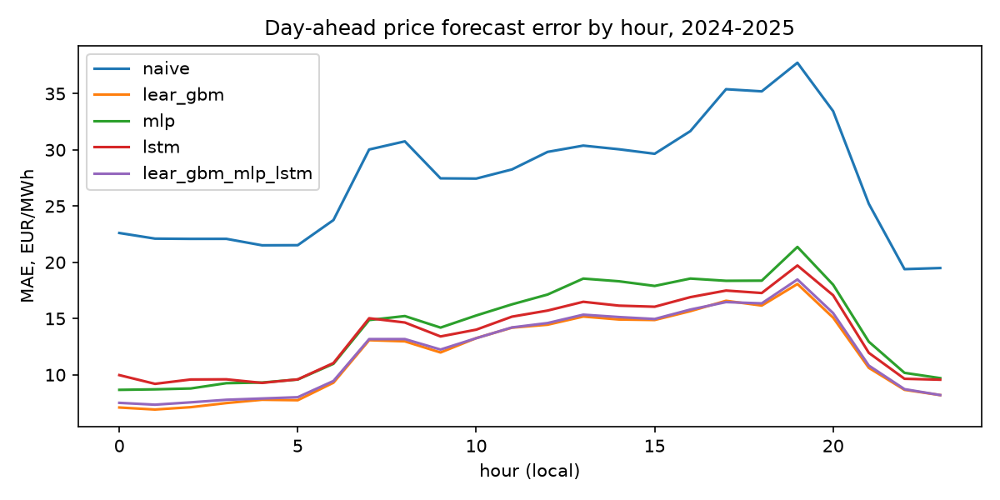
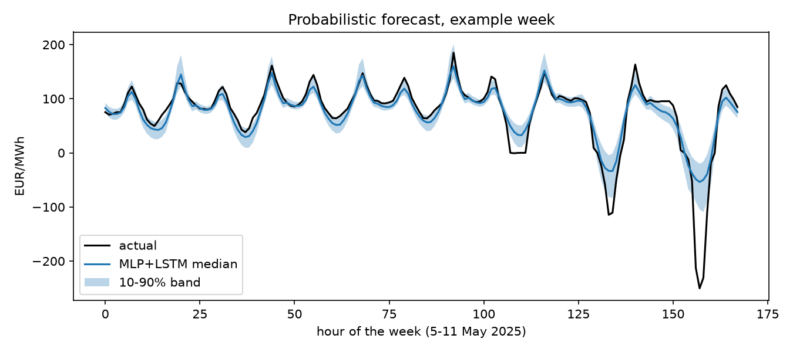

# de-price-forecast-service

Day-ahead power price forecasts for Germany (bidding zone DE-LU) with PyTorch neural networks,
served through a FastAPI endpoint, packaged as a Docker image and refreshed every evening by a
scheduled GitHub Actions job that also scores past forecasts against realised prices.

**Live page:** https://huggingface.co/spaces/michaelserikov/de-price-forecast (tomorrow's forecast,
live accuracy and the backtest, read from the files the daily job commits here).

The forecasting study behind it, with LEAR and gradient boosting benchmarks, is
[de-power-market-ppa](https://github.com/michaelserikov/de-power-market-ppa) v0.5-v0.6. This
repository adds neural networks, a walk-forward comparison with those benchmarks on identical
inputs, and the engineering around a model that runs every day.

## Results (walk-forward backtest, 2024-2025, 731 days x 24 hours)

Each month is forecast by models trained only on the 728 days before it (monthly recalibration,
three seeds per network averaged). Inputs for day d are the information of day d-1: prices up to
d-1, the TSOs' day-ahead load, wind and solar forecasts for d, calendar, the last EU allowance
auction price and the previous month's TTF gas price.

| Model | MAE (EUR/MWh) | rMAE vs naive | RMSE | Pinball | 80% interval coverage |
|---|---|---|---|---|---|
| Naive (d-1 / d-7) | 27.38 | 1.000 | 43.18 | | |
| MLP (249 inputs, PyTorch) | 14.19 | 0.518 | 25.50 | 4.76 | 67.7% |
| LSTM (bidirectional over the 24 hours) | 13.52 | 0.494 | 24.73 | 4.59 | 67.0% |
| MLP + LSTM average | 13.19 | 0.482 | 24.44 | 4.41 | 70.9% |
| LEAR + gradient boosting (de-power-market-ppa) | **11.97** | **0.437** | 22.57 | | |
| LEAR + GBM + MLP + LSTM | 12.16 | 0.444 | 23.05 | | |

Findings:

- Both networks halve the naive error, and the LSTM is more accurate than the MLP (Diebold-Mariano
  p < 0.001): sharing information across the hours of the delivery day helps.
- The linear LEAR model combined with gradient boosting remains the best point forecast on these
  inputs (DM p < 0.001 against every network). This matches the literature, where well-specified
  LEAR models are hard to beat without careful hyperparameter search and larger ensembles.
- Adding the networks to LEAR + GBM does not help over the two years (12.16 vs 11.97); in 2025
  alone the four-model average is level with it (11.49 vs 11.53).
- The 10-90% quantile bands cover 67-71% of hours instead of 80%: the quantile networks are
  overconfident, as is common for pinball-trained networks with early stopping. Interval
  calibration is the first item of the next version.




## Service

```bash
pip install torch --index-url https://download.pytorch.org/whl/cpu
pip install -e ".[test]"
uvicorn dpfs.service:app --port 8000
```

| Endpoint | Returns |
|---|---|
| `GET /health` | status and whether a trained model is loaded |
| `GET /model` | members of the ensemble with training window, seed and validation loss |
| `GET /forecast?day=YYYY-MM-DD` | 24 hourly forecasts for the delivery day: 10%, 50% (point forecast) and 90% quantiles in EUR/MWh |

```bash
curl "http://localhost:8000/forecast?day=2026-01-02"
{"day": "2026-01-02", "unit": "EUR/MWh", "zone": "DE-LU",
 "hours": [{"hour": 0, "q10": -25.5, "q50": 14.2, "q90": 41.45}, ...]}
```

Inputs are downloaded from SMARD and the fuel sources on request and cached under `data/`. If
SMARD is unreachable, the cached weekly files are used. The service returns 404 when the TSO
forecasts for the requested day are not yet published and 503 when no model is trained.

### Docker

```bash
docker build -t dpfs .
docker run -p 8000:8000 dpfs
```

The image uses CPU-only PyTorch and ships the current model from `models/latest`. CI builds the
image on every push, starts the container and checks `/health` and `/model`.

## Daily job

`.github/workflows/daily.yml` runs `python -m dpfs.daily` every evening at 19:30 UTC, after the TSO
forecasts for the next day appear on SMARD:

1. refresh the data (cached between runs),
2. retrain the ensemble (three MLPs and three LSTMs on the last 728 days) when the model is older
   than 30 days,
3. forecast tomorrow and write `forecasts/<day>.csv`,
4. score every past forecast whose prices are published and update `forecasts/performance.csv`
   (MAE, pinball loss and 80% coverage), so live accuracy can be compared with the backtest,
5. commit the forecast and, after retraining, the model.

Since v0.2 the job also checks the inputs before forecasting and monitors drift (below); a drift alarm
retrains the ensemble the same evening.

## v0.2: data checks, drift monitoring, MLflow and a deployable Space

What a model that runs every day needs besides the model.

- **Data checks** (`dpfs/checks.py`, before every forecast in the service and the daily job). Errors stop
  the forecast (the service answers 422 with the reasons): TSO load and renewable forecasts missing or
  outside plausible ranges for the day, missing or implausible prices on the lag days (d-1, d-2, d-3,
  d-7), missing fuel prices. Warnings are returned with the forecast: a jump in the TSO forecasts far
  outside the last 60 days, and fuel prices carried forward from an old publication (EUA auction older
  than 14 days, gas more than one month beyond its month).
- **Drift monitoring** (`dpfs/drift.py`). Hourly prices, load, renewables and residual load of the last
  28 days against the same season of the training window (population stability index, 10 bins,
  Laplace smoothing; comparing with the whole year flagged every winter). Gas and EUA prices are levels
  that move over years, so they are flagged when their recent mean leaves the 5-95% range of training.
  Live accuracy: mean absolute error of the last 14 scored days against the backtest MAE of the
  ensemble (13.19 EUR/MWh); a ratio above 1.5 raises an alarm. A significant shift in residual load, gas
  or EUA, or the accuracy alarm, triggers a retrain. The report goes to `forecasts/monitoring.json`
  and the new `GET /monitoring` endpoint.
- **Experiment tracking** (`dpfs/tracking.py`, optional: `pip install -e ".[mlops]"`). Every retraining
  is an MLflow run with its parameters, the validation pinball loss of each member, the check and drift
  reports and the model files; every daily run logs the live accuracy. SQLite store (`mlflow.db`),
  `mlflow ui --backend-store-uri sqlite:///mlflow.db`. Without MLflow the job runs the same.
- **Live page** on a static Hugging Face Space (`deploy/hf-static/`): it reads the daily forecasts and
  scores from this repository in the browser, so it updates without redeploying.
- **Deployment of the API as a Hugging Face Docker Space**, prepared (Docker Spaces need a paid plan):
  `deploy/huggingface/` (Dockerfile running as user 1000 on port 7860, Space card),
  `scripts/deploy_hf.py` (dry run by default, `--push` uploads the package, the current model and the
  latest monitoring files) and a manual workflow `.github/workflows/deploy-hf.yml`.

**What the checks found on the live inputs (7 November 2026).** Running them on real data exposed three
faults in v0.1, now fixed:
- *Gas price frozen since January.* The World Bank moves the Pink Sheet to a new address with every
  monthly release, and v0.1 used a fixed address whose file ends in December 2025 (9.48 USD/MMBtu).
  The October 2026 value is 28.50 USD/MMBtu, three times higher. The daily model therefore forecast
  2026 prices with a gas input far below the market. The current address is now read from the World
  Bank commodity markets page and the file is refreshed weekly. With the current value the drift check
  flags gas (28-day mean 77.8 EUR/MWh against a training range of 30.8 to 50.3) and asks for a retrain.
- *Forecasts for days without TSO forecasts.* Load and renewable forecasts were interpolated towards
  both ends, so a day not yet published took the previous day's TSO forecast instead of returning 404.
  Only gaps between published days are filled now.
- *The endpoint failed for 2026 days.* It loads ten days of history, and the EU allowance archive ends
  in 2025, so no auction year was found; the latest published year is now always loaded and carried
  forward, and the check warns about its age (327 days on 7 November 2026).

Checked locally on real data: `/health`, `/model`, `/monitoring` and `/forecast?day=2026-11-07`
(answers with the EUA age warning), and `/forecast?day=2026-11-09` returns 404 because the TSO
forecasts are not published yet. The Docker image is built in CI.

## Method

- **MLP:** the 249 inputs of the LEAR benchmark (prices of d-1, d-2, d-3, d-7; load and
  renewable forecasts of d, d-1, d-7; weekday; EUA; gas), two hidden layers (256, 128), dropout,
  output 24 hours x 3 quantiles.
- **LSTM:** a bidirectional LSTM (64 units) over the 24 hours of day d; each hour has 25 features
  (its price lags, the previous day's mean, minimum and maximum, load, renewable and residual load
  forecasts, hour and weekday encodings, EUA, gas).
- **Training:** prices and price features transformed with asinh((x - median) / MAD) as in LEAR,
  all features standardised on the training window; pinball loss for the 10%, 50% and 90%
  quantiles; Adam, early stopping on the most recent 10% of the window; quantiles sorted so they
  never cross; ensembles average the members quantile by quantile.
- **Evaluation:** MAE, RMSE, relative MAE against the naive forecast, Diebold-Mariano test on the
  daily L1 norm of the 24 errors, pinball loss and empirical coverage of the 10-90% band.

Reproduce the backtest (about 17 minutes on a laptop CPU):

```bash
python -m dpfs.backtest --baseline ../de-power-market-ppa/results/forecast
```

## Limitations

- The TSO wind and solar forecasts for day d are published on SMARD around 18:00 on d-1, after
  the 12:00 day-ahead auction. The price forecasting literature uses the same series; a trading
  desk would use its own weather-based forecasts available before noon.
- The EEX auction archive used for EU allowance prices ends in 2025; the 2026 auction results are
  only in EEX's market data hub, so the last 2025 price is carried forward and flagged by the checks.
  The World Bank gas series is published with a lag of about a month.
- The ensemble in `models/latest` of this repository was trained on 2024-2025 inputs; the daily job
  retrains it, now also on drift alarms.
- Out-of-sample study and demonstration service on public data, not a trading system. No
  hyperparameter search yet; the networks use one fixed configuration.

## Next

- Calibrate the quantile bands (conformal adjustment on recent residuals) and track calibration
  in the daily scoring.
- A current-year source for EU allowance prices.
- Hyperparameter search and larger ensembles.

## Tests

`pytest -q` runs 23 offline tests on synthetic data: feature construction and alignment, scaler
round trip, carry-forward of fuel prices, pinball loss, training of both networks (beats the
naive forecast, ordered quantiles), save and load of the ensemble, walk-forward without
look-ahead, the API endpoints and error codes, the daily scoring and retraining rule, and (v0.2) the
data checks, the drift statistics and alarms, the monitoring endpoint and MLflow logging (skipped when
MLflow is not installed).

## Data

SMARD (Bundesnetzagentur | SMARD.de, CC BY 4.0): day-ahead prices and TSO day-ahead forecasts.
World Bank Commodity Price Data (Pink Sheet), ECB reference rates and EEX primary auction results
for fuel and carbon prices. Raw data are downloaded on first use and not committed.
